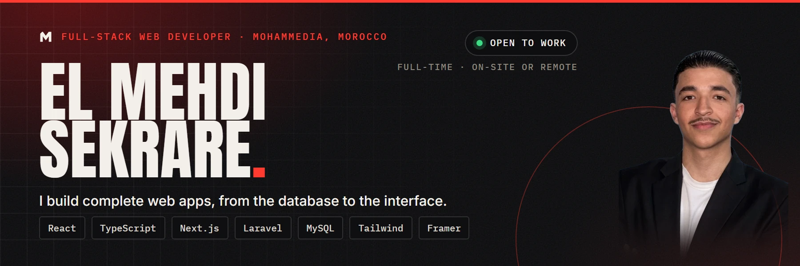
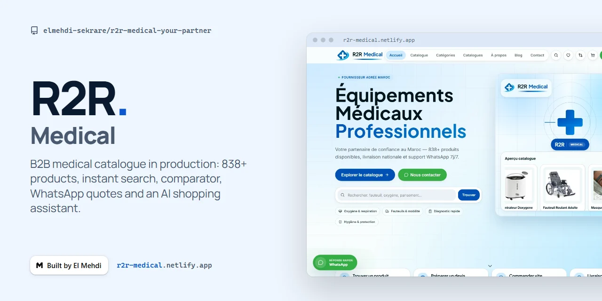
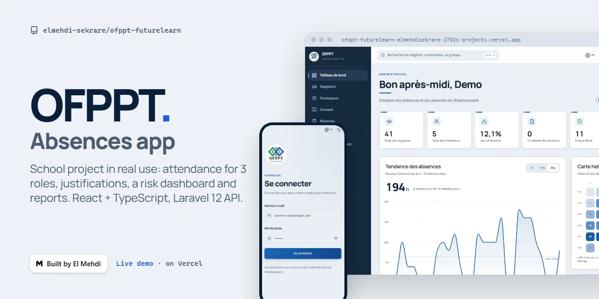
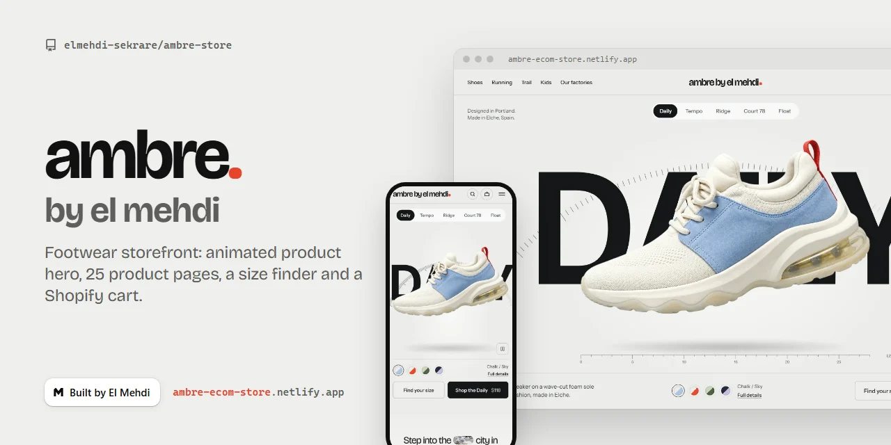
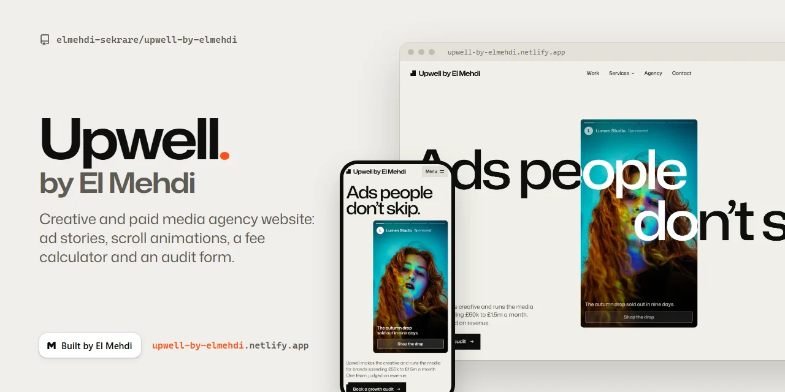
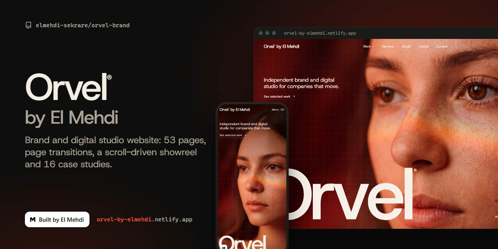
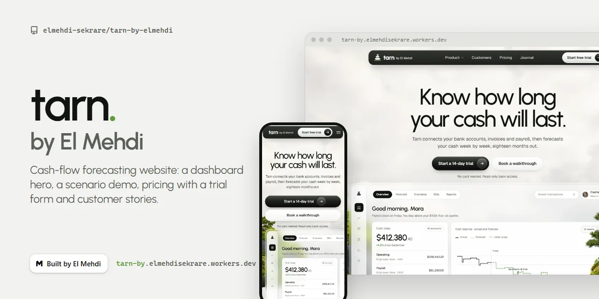
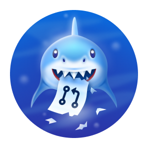

  
  
  
  

  
  
  
  

 

## ✦ About me

I'm a **full-stack web developer** from Mohammedia, Morocco. I build complete web applications, from the database and the API to the interface, and I care about performance, clean code and the experience of the people using them.

- 🎓 **Top of my class** (*major de promotion*, mention Très Bien) in Web Development at **ISTA (OFPPT)**, 2024–2026. Now in a **Licence in Computer Engineering** (evening classes) at École High-Tech.
- 💼 **Full-stack internship at R2R Medical** (May–June 2026, Casablanca, on site): shipped their B2B product catalogue to production.
- 🏫 **Built my school's attendance app**: in real use on the institute's local network.
- 🚀 Running **[Visumed](https://visumed-by.elmehdii.workers.dev/)**, my freelance studio: showcase sites, online stores and web apps.
- 🌍 Arabic (native) · English (fluent) · French (intermediate).
- 📫 **Open to full-time roles, available now**, on site or remote: [elmehdisekrare@gmail.com](mailto:elmehdisekrare@gmail.com)

 

## ✦ Featured work

<table>
  <tr>
    <td width="50%" valign="top">
      
      <h3>R2R Medical · internship, in production</h3>
      B2B catalogue for a medical supplier: <b>838+ products</b>, filters, instant search and a comparator. The cart becomes a pre-filled <b>WhatsApp quote</b> sent to the right sales rep, plus an <b>AI shopping assistant</b> (OpenAI API), French / Arabic and SEO.  
      <code>React 19</code> <code>TypeScript</code> <code>TanStack Start (SSR)</code> <code>TanStack Query</code> <code>Tailwind</code>  
      <a href="https://r2r-medical.netlify.app/"><b>Live site ↗</b></a> · <a href="https://github.com/elmehdi-sekrare/r2r-medical-your-partner">Code</a>
    </td>
    <td width="50%" valign="top">
      
      <h3>OFPPT Absences · school project, in real use</h3>
      Attendance and absence management for my institute, running on the <b>school's local network</b>: 3 roles, attendance in one screen, justification workflow, risk dashboard, reports, Excel imports, e-mails, <b>41 feature tests</b>.  
      <code>React</code> <code>TypeScript</code> <code>Laravel 12</code> <code>REST API</code> <code>Sanctum</code> <code>MySQL / SQLite</code> <code>PowerShell</code>  
      <a href="https://ofppt-futurelearn-elmehdisekrare-2792s-projects.vercel.app/"><b>Try the demo ↗</b></a> · <a href="https://github.com/elmehdi-sekrare/ofppt-futurelearn">Code</a>
    </td>
  </tr>
  <tr>
    <td width="50%" valign="top">
      
      <h3>Ambre · e-commerce</h3>
      Footwear store connected to <b>Shopify</b>: 25 product pages with variants, a catalogue filterable in 8 categories, live cart and prices. Pre-built pages, local assets and cached data for fast loads.  
      <code>Framer</code> <code>Shopify Storefront API</code> <code>GraphQL</code> <code>JavaScript</code>  
      <a href="https://ambre-ecom-store.netlify.app/"><b>Live site ↗</b></a> · <a href="https://github.com/elmehdi-sekrare/ambre-store">Code</a>
    </td>
    <td width="50%" valign="top">
      
      <h3>Upwell · agency website</h3>
      13-page site for a creative and paid media agency: an animated "stories" hero, scroll-driven video wall, case studies and a live fee calculator.  
      <code>Astro</code> <code>GSAP + ScrollTrigger</code> <code>Lenis</code> <code>JavaScript</code>  
      <a href="https://upwell-by-elmehdi.netlify.app/"><b>Live site ↗</b></a> · <a href="https://github.com/elmehdi-sekrare/upwell-by-elmehdi">Code</a>
    </td>
  </tr>
  <tr>
    <td width="50%" valign="top">
      
      <h3>Orvel · studio website</h3>
      53 pages: 16 case studies, a 30-article journal, a multi-step brief form, page-transition covers and WebGL effects.  
      <code>Astro</code> <code>WebGL</code> <code>Lenis</code> <code>JavaScript</code>  
      <a href="https://orvel-by-elmehdi.netlify.app/"><b>Live site ↗</b></a> · <a href="https://github.com/elmehdi-sekrare/orvel-brand">Code</a>
    </td>
    <td width="50%" valign="top">
      
      <h3>Tarn · SaaS website</h3>
      Product site for a cash-flow forecasting app: a live dashboard hero, a scenario demo, pricing with a trial form and customer stories, served from Cloudflare's edge.  
      <code>Astro</code> <code>GSAP</code> <code>Cloudflare Workers</code> <code>JavaScript</code>  
      <a href="https://tarn-by.elmehdisekrare.workers.dev/"><b>Live site ↗</b></a> · <a href="https://github.com/elmehdi-sekrare/tarn-by-elmehdi">Code</a>
    </td>
  </tr>
</table>

More: <a href="https://github.com/elmehdi-sekrare/tubwell-by-elmehdi"><b>Tubwell</b></a> (grooming studio with booking and a pickup shop, <a href="https://tubwell-by-elmehdi.netlify.app/">live</a>) · every project with a case study on <a href="https://portfolio.elmehdii.workers.dev/">my portfolio</a> and <a href="https://visumed-by.elmehdii.workers.dev/works">my studio</a>.

Upwell, Orvel, Ambre, Tarn and Tubwell start from Visuvate templates that I customised, extended and deployed; each repo credits its base.

 

## ✦ Tech stack

| | |
|---|---|
| **Frontend** |  |
| **Backend** |  |
| **Databases** |  |
| **Design & motion** |    |
| **DevOps & tools** |  |

Also: TanStack (Start, Query, Router), shadcn/ui, Framer Motion, REST APIs, GraphQL, Shopify Storefront API, OpenAI API, n8n automations, PL/SQL, Jest, PHPUnit, Agile (Scrum), UML, Merise.

 

## ✦ GitHub achievements

<table>
  <tr>
    <td align="center" width="160"> <b>Pull Shark</b> Pull requests merged</td>
    <td align="center" width="160"> <b>Quickdraw</b> Closed an issue or PR within 5 minutes</td>
    <td align="center" width="160"> <b>YOLO</b> Merged a pull request without review</td>
  </tr>
</table>

Badge artwork from <a href="https://github.com/fenrir2608/badgeMaster">fenrir2608/badgeMaster</a> (MIT).

 

## ✦ Contributions

<picture>
  <source media="(prefers-color-scheme: dark)" srcset="https://raw.githubusercontent.com/elmehdi-sekrare/elmehdi-sekrare/output/github-snake-dark.svg">
  <source media="(prefers-color-scheme: light)" srcset="https://raw.githubusercontent.com/elmehdi-sekrare/elmehdi-sekrare/output/github-snake.svg">
  
</picture>

 

   
  <b>Let's build something.</b> <a href="mailto:elmehdisekrare@gmail.com">elmehdisekrare@gmail.com</a> · <a href="https://www.linkedin.com/in/el-mehdi-sekrare-77000629b">LinkedIn</a> · <a href="https://portfolio.elmehdii.workers.dev/">Portfolio</a>

